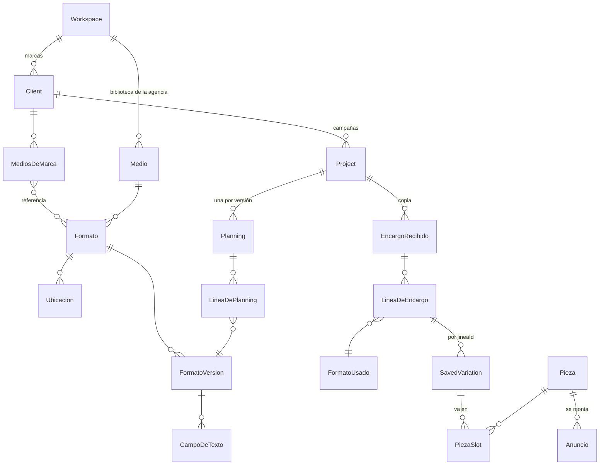

# Arquitectura de datos

Estado: vigente · 2026-11-19 (reemplaza la propuesta del 2026-10-28) · Base: PostgreSQL + Prisma, una sola
base (decisión 12) · Decisión 28 cierra lo que quedaba abierto.
Fuente de lo actual: `server/prisma/schema/`, un archivo por módulo (`base`, `comun`, `myvoice`, `portal`,
`produccion`; CDM e Implementación suman el suyo), 26 modelos al 2026-11-19.

Una sola base con las tablas repartidas en cinco módulos: parte común, CDM, My Voice, Producción e
Implementación. F1 a F5 suman unas 15 tablas, todas aditivas.

## 1. Reglas

1. **Una base, tablas por módulo.** Cada tabla tiene un módulo dueño; solo ese módulo la escribe. Los
   demás la leen por `contrato/` o reciben una copia.
2. **Aditivo.** Ninguna tabla de hoy se borra ni cambia de significado mientras se use: tablas nuevas,
   columnas nullable y valores de enum nuevos. Así cada entrega se despliega con `plataformaPorProcesos`
   apagado.
3. **Tenencia por workspace.** Todo lleva `workspaceId`, y `clientId` cuando es de una marca; lo ajeno
   responde 404. La biblioteca de medios es general, de la agencia: lleva `workspaceId` y no `clientId`
   (decisiones 25 y 28).
4. **Lo escrito guarda con qué se escribió.** Copy, piezas y anuncios guardan la versión del formato, de la
   sábana y del ADN con que se hicieron (snapshot).
5. **Lo que se calcula no se guarda.** Etapa del copy, paso de la campaña, «espera a» y Mi cola se calculan
   al leer.
6. **Los costos de IA se guardan, pero solo salen por Control** (decisión 27).

## 2. Mapa por módulo

**(hoy)** existe en producción · **(nuevo)** llega con la entrega que se indica.

### Parte común

| Tabla | Qué guarda | Estado |
|---|---|---|
| `Workspace` | La empresa; `plataformaPorProcesos` elige el marco | hoy |
| `User`, `Membership`, `WorkspaceInvite` | Personas y su acceso; `User.superAdmin` | hoy |
| `Client` | La marca, con `marcaMadreId` | hoy |
| `SeccionAdn`, `AdnVersion`, `AudienciaDeMarca` | ADN 2.0 por secciones, sus versiones y las audiencias | hoy |
| `Project` | La campaña: responsable, modo de aprobación, `adnVersion` | hoy · F3 suma fechas |
| `MiembroFuncion` | Funciones por persona y marca | hoy · F1: enum suma `ESTRATEGIA`, `PLANNING`, `TRAFFICKER` |
| `Notificacion` | Avisos | hoy · F4 suma `modulo`, `campanaId`, `destino` |
| `ModuloDeMarca` | Qué módulos tiene encendidos la marca (CDM, Implementación) | nuevo · F1 |
| `CampanaAudiencia` | Audiencias del ADN elegidas para la campaña | nuevo · F3 |

### CDM (todo nuevo)

| Tabla | Qué guarda | Entrega |
|---|---|---|
| `Medio` | Meta, Google, programática… con su estado y su **clase** (Pagos, Redes sociales, Propios, Tradicional; decisión 29) | F2 |
| `Formato` | La **pieza maestra**: tipo de archivo y proporción (decisión 18) | F2 |
| `FormatoVersion` | Medidas y guía visual como datos (lienzo, zona segura, dónde va cada texto) | F2 |
| `Ubicacion` | Las ubicaciones que cubre la pieza, con sus largos y la alerta «por confirmar» | F2 |
| `CampoDeTexto` | Clave, zona (en pieza o plataforma), unidad, máximo, repeticiones | F2 |
| `CargaDePlanilla` | Historial de cargas desde planilla | F2 |
| `MediosDeMarca`, `MedioDeMarcaFormato` | Los formatos habituales de una marca: solo referencias a la biblioteca | F2 |
| `Planning` | Una versión por envío, con su estado | F3 |
| `LineaDePlanning` | Formato × etapa × piezas, ubicaciones elegidas, fechas, destino y UTM, `lineaId` estable | F3 |

### My Voice

| Tabla | Qué guarda | Estado |
|---|---|---|
| `SavedVariation` | El copy | hoy · F4 suma `lineaId` |
| `ContentDNAProfile` | Brief de v1 | hoy · se deja de escribir en F3 (decisión 28) |
| `GenerationLog`, `UsagePeriod` | Costo y cuota (solo los ve Control) | hoy |
| `NegativeFeedback`, `GenerationPreset` | Aprendizaje y preajustes de v1 | hoy |
| `EncargoRecibido`, `LineaDeEncargo` | La copia de la sábana aprobada, por versión | nuevo · F4 |
| `FormatoUsado` | Snapshot de los campos de texto del formato y su versión | nuevo · F4 |

### Producción (módulo propio desde F0c)

| Tabla | Qué guarda | Estado |
|---|---|---|
| `Pieza`, `PiezaSlot`, `PiezaEvento` | La pieza, qué texto va y su historial | hoy |
| `PiezaVersion`, `Hallazgo` | Cada entrega y lo que encontró la auditoría | hoy |

### Implementación

| Tabla | Qué guarda | Estado |
|---|---|---|
| `Anuncio` | Pieza (única), destino y UTM sin sábana, estado, plataforma, ID en la plataforma, fecha real, novedad. La línea sale del copy (`SavedVariation.lineaDePlanningId`), no se guarda | hecho · F5 (1) |
| `AnuncioEvento` | Historial append-only, como `PiezaEvento` | hecho · F5 (1) |

### Portal del cliente (plataforma)

`ReviewSession`, `ReviewSessionItem`, `ReviewSubmission`, `ReviewItemFeedback`: una ronda por envío
(`COPY`, `PIEZA`). F3b suma `SABANA` y `ReviewSessionItem.planningId` (la sábana entera, no una línea); el
`CHECK` de la migración pasa de XOR a «exactamente uno» entre copy, pieza y planning (`num_nonnulls`).
`EstadoPlanning` suma `CON_EL_CLIENTE`.

## 3. Relaciones

**CDM y My Voice se tocan solo por una copia.** El paso de `LineaDePlanning` a `LineaDeEncargo` y de
`FormatoVersion` a `FormatoUsado` no es una llave foránea: es la copia que hace el contrato al aprobarse la
sábana, y My Voice compara versiones por `lineaId`. Sin CDM encendido, el copy nace sin línea, como hoy.

## 4. Qué lee cada módulo de los otros

| Quién lee | Qué | De quién | Cómo | Estado |
|---|---|---|---|---|
| My Voice | La sábana aprobada | CDM | Copia al aprobarse | F4 |
| CDM | Copy y piezas por línea (tablero P7) | My Voice, Producción | Contrato, al leer | F3 + F4 |
| Producción | Copy aprobado de la pieza | My Voice | Hoy lee `SavedVariation` directo; debe ir por contrato | **Deuda** |
| Producción | Formato, medidas, guía visual | CDM | Contrato | F2 |
| Implementación | Copy, pieza, destino, UTM, aprobaciones | My Voice, Producción, CDM | Contrato, al leer | F5 |
| Parte común (encabezado, Panorama) | Avance de copy y piezas | My Voice, Producción | Hoy `comun/proceso.ts` lee las tablas; debe pedirlo a cada módulo | **Deuda** |
| Todos | Marca, ADN, campaña, equipo | Parte común | Contrato | hoy, contado |

Las dos deudas se pagan antes de F4, cuando el copy empieza a llegar por línea.

## 5. Migraciones, en orden

| Entrega | Qué suma | Módulo |
|---|---|---|
| Hecho (2026-11-19) | `Workspace.plataformaPorProcesos`, `User.superAdmin` | Parte común |
| F1 | `FuncionEquipo` + `ESTRATEGIA`, `PLANNING`, `TRAFFICKER` (un `ALTER TYPE … ADD VALUE` por sentencia); `User.ultimaRuta`; `ModuloDeMarca` | Parte común |
| Hecho (2026-11-19) | `schema.prisma` partido por módulo en `server/prisma/schema/` (`prismaSchemaFolder`, decisión 28). Sin migración: el esquema es idéntico | Todos |
| F2 | `cdm.prisma` con `Medio`, `Formato`, `FormatoVersion`, `Ubicacion`, `CampoDeTexto`, `CargaDePlanilla`, `MediosDeMarca`, `MedioDeMarcaFormato` | CDM |
| Hecho (2026-11-19) · F3a | `Planning`, `LineaDePlanning`, `EventoDePlanning` | CDM |
| Hecho (2026-11-20) · F3b | `RondaRevision` + `SABANA`, `ReviewSessionItem.planningId`, `EstadoPlanning` + `CON_EL_CLIENTE` | CDM, portal |
| Hecho (2026-11-20) · decisión 30 | `AprobadorDeCampana(projectId, userId, agregadoPorId)`: aprobadores sumados a una campaña | Parte común |
| Hecho (2026-11-20) · F4 (1) | `SavedVariation.lineaDePlanningId`. **Sin `EncargoRecibido` ni `LineaDeEncargo`:** un pedido es la línea de la sábana aprobada y su estado se calcula al leer | My Voice |
| Por hacer | `Project` + fechas; `CampanaAudiencia`; `FormatoUsado`; `Notificacion` + `modulo`, `campanaId`, `destino` | Parte común, My Voice |
| Hecho (2026-11-23) · F5 (1) | `Anuncio`, `AnuncioEvento` (`implementacion.prisma`); `LineaDePlanning` + `destino`, `utm`. El historial de aprobaciones será una vista de lectura, sin tabla (decisión 28) | Implementación, CDM |

Cada migración pasa el chequeo de deriva de CI (`migrate diff`) y `verify:isolation` con sus rutas nuevas.

## 6. Abierto

- **El caso Terpel**: la biblioteca es general, de la agencia. Si Terpel tiene workspace propio o necesita
  algo suyo, se plantea con Terpel antes de F2.
