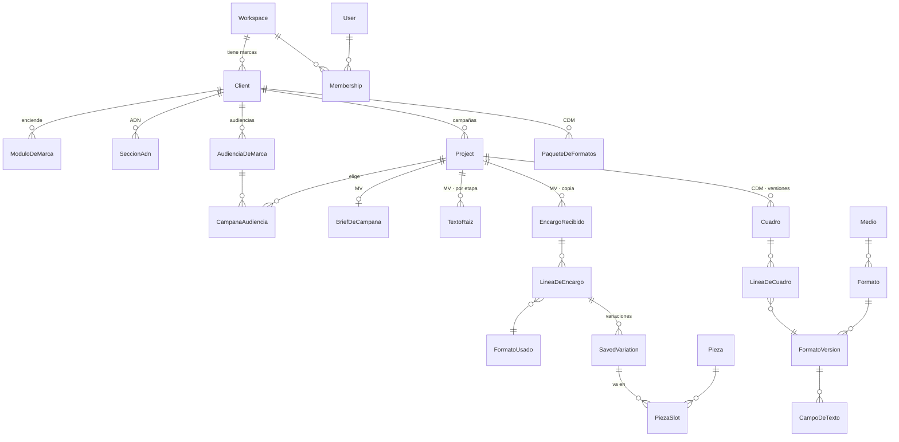

# Arquitectura de datos

Estado: propuesta · 2026-10-28 · Base: PostgreSQL + Prisma, una sola base (decisión 12)
Fuente de lo actual: `server/prisma/schema.prisma` (25 modelos al 2026-10-28)

## 1. Reglas

1. **Una base, tablas por módulo.** Cada tabla tiene un módulo dueño; solo ese módulo la escribe y la
   lee. Los demás piden los datos por `contrato/`.
2. **Aditivo.** Ninguna tabla de hoy se borra ni cambia de significado mientras esté en uso. Lo nuevo son
   tablas nuevas, columnas nullable y valores de enum nuevos.
3. **Tenencia igual que hoy.** Todo lo de una marca lleva `workspaceId` (y `clientId` donde aplica);
   lo ajeno responde 404. Lo único global es la biblioteca de medios, que no tiene datos de clientes.
4. **Lo escrito guarda con qué se escribió.** Copy, textos raíz y piezas guardan la versión del formato,
   del encargo y las audiencias con que se escribieron (snapshot), para que un cambio posterior no los
   altere en silencio.
5. **Lo que se puede calcular no se guarda.** Etapa del copy, «espera a», cola por persona y estado por
   línea se calculan al leer.

## 2. Mapa por módulo

Marcado: **(hoy)** existe en producción · **(nuevo)** por construir · **(cambia)** existe y suma columnas.

### Parte común

| Tabla | Qué guarda | Estado |
|---|---|---|
| `Workspace` | La empresa (agencia o cliente) | hoy |
| `User`, `Membership`, `WorkspaceInvite` | Personas y su acceso por workspace | hoy |
| `Client` | **La marca** (con `marcaMadreId` para submarcas) | hoy |
| `ModuloDeMarca` | Qué módulos tiene encendidos la marca | nuevo |
| `SeccionAdn`, `FuenteDeMarca` | ADN 2.0 por secciones, con estado y origen | nuevo |
| `AudienciaDeMarca` | Lista fija de audiencias de la marca | nuevo |
| `Project` | **La campaña** (responsable, modo de aprobación) | cambia: `referencia`, `sigueEn`, fechas |
| `CampanaAudiencia` | Audiencias del ADN elegidas para la campaña | nuevo |
| `MiembroFuncion` | Funciones por persona y marca | cambia: enum suma `ESTRATEGIA`, `PLANNING` |
| `Notificacion` | Avisos | cambia: `modulo`, `campanaId`, `destino` |

### My Voice

| Tabla | Qué guarda | Estado |
|---|---|---|
| `ContentDNAProfile` | Brief de v1 (1:1 con la campaña) | hoy; convive con `BriefDeCampana` |
| `BriefDeCampana` | Concepto, campo semántico, mensaje, tono, CTA, etapas previstas, con origen de cada campo | nuevo |
| `TextoRaiz` | Idea por etapa, con voto y motivo | nuevo |
| `ReviewSession` (+ `Item`, `Submission`, `ItemFeedback`) | Portal sin cuenta: copy, piezas y **toolkit** | cambia: `RondaRevision` suma `TOOLKIT` |
| `EncargoRecibido`, `LineaDeEncargo` | Copia por versión del cuadro de CDM | nuevo |
| `FormatoUsado` | Snapshot de los campos de texto de un formato y su versión | nuevo |
| `SavedVariation` | Copy aprobado y por aprobar | cambia: `lineaId`, `campoClave`, `ubicacion`, `textoRaizId`, `formatoUsadoId` |
| `GenerationLog`, `UsagePeriod` | Costo y cuota por generación | hoy |
| `NegativeFeedback`, `GenerationPreset` | Aprendizaje y preajustes de v1 | hoy |
| `Pieza`, `PiezaSlot`, `PiezaEvento`, `PiezaVersion`, `Hallazgo` | Producción y auditoría | hoy |

### CDM

| Tabla | Qué guarda | Estado |
|---|---|---|
| `Medio` | Meta, Google, programática… con su clase y estado (borrador, activo, oculto) | nuevo |
| `Formato`, `FormatoVersion` | El formato y cada versión con medidas, campos de texto y archivo | nuevo |
| `CampoDeTexto` | Clave, ubicación (en pieza o plataforma), unidad, máximo, mínimo, repeticiones | nuevo |
| `PaqueteDeFormatos`, `PaqueteFormato` | Formatos habituales de una marca | nuevo |
| `Cuadro`, `LineaDeCuadro` | El encargo por versión: formato, etapa, variaciones, fechas | nuevo |
| `CargaDePlanilla` | Historial de cargas con su revisión | nuevo |

## 3. Relaciones

Las líneas «MV» y «CDM» se tocan solo en `Project` y `Client` (parte común). El paso de `LineaDeCuadro`
a `LineaDeEncargo` y de `FormatoVersion` a `FormatoUsado` **no es una relación de base**: es una copia
que hace el contrato al recibir una versión.

## 4. Ids que cruzan módulos

| Id | Lo crea | Lo usan |
|---|---|---|
| `clientId` (marca) | Parte común | Todos |
| `projectId` (campaña) | Parte común | Todos |
| `lineaId` | CDM | My Voice para comparar versiones |
| `formatoId` + `version` | CDM | My Voice en `FormatoUsado` |

## 5. Migraciones

Todas aditivas, en el orden de las entregas: parte común (módulos, ADN, audiencias, campaña) → My Voice
(brief, textos raíz, toolkit) → CDM (biblioteca, cuadro) → My Voice (encargo, formato usado, copy por
línea). Cada una pasa el chequeo de deriva de CI (`migrate diff`) y `verify:isolation`.

## 6. Abierto

- **Quién edita la biblioteca global**: la función Planning es por workspace. Si un workspace cliente
  tiene un Planning, ¿puede editar la biblioteca de todos? Propuesta: la editan solo los Planning del
  workspace de la agencia; los demás la leen y piden cambios.
- **`ContentDNAProfile` y `BriefDeCampana`**: cuándo se migra el brief de v1 al nuevo y se deja de
  escribir el viejo.
- **Un archivo de esquema por módulo** (`prismaSchemaFolder`): confirmar la versión de Prisma del
  proyecto antes de partir el esquema.
