# Flujo de una campaña · quién, dónde, qué se aprueba y qué se avisa

Estado: propuesta · 2026-10-28 · Términos: [glosario.md](./glosario.md)
Antecedente: [../v2/mapa-del-proceso.md](../v2/mapa-del-proceso.md), que este documento extiende a
las dos herramientas.

## 1. El recorrido

```mermaid
flowchart LR
  subgraph Comun[Parte común · marca transversal]
    S[Super Admin crea la marca<br/>y elige herramientas]
    E[Estrategia completa el ADN<br/>y las audiencias]
    M1[1 · Responsable crea la campaña<br/>y elige cómo sigue]
  end
  B[Planning mantiene la biblioteca<br/>y los paquetes · CDM]
  subgraph MV[My Voice]
    M2[2 · Copy escribe el brief<br/>frentes y referencia]
    M2 --> M3[3 · IA escribe textos raíz<br/>Copy los depura]
    M3 --> M4[4 · Responsable manda el toolkit]
    M4 --> M5[5 · Cliente aprueba el toolkit]
    M5 --> M7[7 · IA escribe cada formato<br/>con los campos de la biblioteca]
    M7 --> M8[8 · Responsable aprueba de a uno]
  end
  subgraph CDM
    C6[6 · Planning arma el<br/>cuadro de materiales]
  end
  subgraph PR[My Voice · Producción]
    C9[9 · Diseño produce la pieza<br/>con el copy aprobado]
    C10[10 · Responsable y cliente<br/>aprueban la pieza]
  end
  S --> E --> M1
  S --> B
  M1 -- sigue por My Voice --> M2
  M1 -- sigue por CDM --> C6
  M2 -. frentes .-> C6
  B -. biblioteca .-> C6
  C6 -. qué escribir .-> M7
  M8 -. qué texto va en qué formato .-> C9
  C9 --> C10
  C10 -. estado de la pieza .-> C6
  C10 --> MED[My Voice mide<br/>y aprende]
```

Después del paso 1 el responsable **elige cómo sigue la campaña**: directo a My Voice (paso 2) o por
CDM (paso 6). La otra herramienta se suma cuando quiera. El paso 6 corre en paralelo con 2 a 5; el
paso 7 espera al toolkit aprobado y al cuadro.

## 2. Paso a paso

| # | Herramienta | Quién | Hace | Entra | Sale | Pasa a |
|---|---|---|---|---|---|---|
| — | ambas | Super Admin | Crea la marca y decide qué herramientas usa. | — | Marca | Estrategia, Planning |
| — | Parte común | Estrategia (con la IA) | Completa y confirma el ADN; define las audiencias. Mínimo 75 % para crear campañas. | Fuentes de la marca | ADN, audiencias | — |
| — | CDM | Planning | Mantiene la biblioteca de medios y los paquetes de la marca. | Specs de los medios | Formatos activos | — |
| 1 | Parte común | Responsable | Crea la campaña, anota la referencia y **elige cómo sigue**: My Voice o CDM. | ADN apto | Campaña | Copy o Planning |
| 2 | My Voice | Copy | Escribe el brief, elige audiencias del ADN y arma o completa los frentes. | ADN | Brief, frentes | IA; CDM lee los frentes |
| 3 | My Voice | IA → Copy | La IA escribe textos raíz por frente; Copy aprueba, rechaza con motivo o edita. | Brief | Textos raíz | Responsable |
| 4 | My Voice | Responsable | Elige qué textos raíz van y manda el toolkit. | Textos raíz | Toolkit | Cliente |
| 5 | My Voice | Cliente | Aprueba el toolkit en el portal. Un rechazo vuelve a ese frente. | Toolkit | Toolkit aprobado | Paso 7 |
| 6 | CDM | Planning | Arma el cuadro de materiales: formato, frente, cuántos copys, fechas. | Frentes, biblioteca | Cuadro | My Voice |
| 7 | My Voice | IA | Escribe el copy de cada formato (en pieza y de plataforma) desde los textos raíz del frente, dentro de los largos de cada campo. | Toolkit aprobado, cuadro | Adaptaciones | Responsable |
| 8 | My Voice | Responsable | Revisa de a uno: aprobar y seguir, pedir otra versión, editar. Lo que no cabe no se aprueba. | Adaptaciones | Copy aprobado por formato | CDM |
| 9 | My Voice · Producción | Diseño | Produce la pieza con el copy aprobado (después, en el Adaptador). | Copy aprobado, specs | Pieza | Responsable |
| 10 | My Voice · Producción | Responsable, cliente | Aprueban la pieza; el cliente da la URL final. CDM ve el estado. | Pieza | Pieza aprobada | My Voice mide |

## 3. Bloqueos

| Bloqueo | Dónde | Qué ve el usuario |
|---|---|---|
| ADN bajo el mínimo | My Voice, al crear la campaña | Qué falta y un botón para completarlo. |
| Toolkit sin aprobar | My Voice, paso 7 | Las líneas del cuadro esperan, con el motivo. |
| Formato de un medio en borrador | CDM, al armar el cuadro | El formato no aparece para elegir. |
| Copy que no cabe en un campo | My Voice, paso 8 | El campo marcado y «Acortar»; no se puede aprobar. |
| Copy sin aprobar | CDM, en la línea | La línea muestra «Esperando el copy en My Voice». |

## 4. Navegación y avisos

Cada aprobación queda en su herramienta, así que el usuario tiene que saber en todo momento **dónde
está la campaña, qué falta y a quién le toca**, sin importar en qué herramienta esté parado.

Principios:

1. **Una campaña, un estado visible en las dos.** CDM muestra en qué paso de My Voice está la
   campaña y My Voice muestra en qué paso de CDM, con el mismo nombre de etapa.
2. **«Espera a».** Cada campaña dice a quién espera: la persona o la función, no un estado técnico.
3. **Un aviso lleva directo a la acción**, en la herramienta correcta, ya abierta en lo que hay que
   hacer. Nunca a una portada.
4. **Una cola por persona** reúne lo pendiente de todas las campañas y las dos herramientas,
   ordenado por fecha de salida.
5. **Al cruzar de herramienta, se dice.** Un botón que lleva a la otra herramienta dice adónde va
   («Ver el cuadro en CDM»).

| Evento | Se avisa a | Lleva a |
|---|---|---|
| ADN bajo el mínimo al crear una campaña | Estrategia | My Voice · ADN, en la primera sección que falta |
| Textos raíz listos para depurar | Copy | My Voice · Textos raíz, en el frente |
| Textos raíz listos para el toolkit | Responsable | My Voice · Toolkit |
| Toolkit enviado | Cliente | Portal del toolkit |
| Toolkit aprobado | Responsable, Planning | My Voice · Adaptaciones / CDM · Cuadro |
| Toolkit rechazado | Copy, responsable | My Voice · Textos raíz, en el frente rechazado |
| Frente nuevo o cambiado en el brief | Planning | CDM · Cuadro, en las líneas de ese frente |
| Cuadro recibido o cambiado | Responsable | My Voice · Adaptaciones, con lo que cambió |
| Copy listo para aprobar | Responsable | My Voice · Adaptaciones, en el primero pendiente |
| Copy aprobado de una línea | Diseño, Planning | My Voice · Producción / CDM · Línea |
| Pieza lista para aprobar | Responsable, cliente | My Voice · Producción |
| Copy aprobado que cambió después | Diseño, Planning | My Voice · Producción (pieza «A revisar») / CDM · Línea |

Lo que falta definir del lado técnico: si las dos herramientas comparten la cola y las
notificaciones (un solo servicio) o cada una manda las suyas con enlaces a la otra. Ver
[decisiones.md](./decisiones.md), preguntas abiertas.
