# Mapa del proceso de campaña · quién hace qué

Estado: propuesta · 2026-10-27
Producto: [prd-proceso-de-campana.md](./prd-proceso-de-campana.md) · Spec:
[spec-proceso-de-campana.md](./spec-proceso-de-campana.md) · Plan de medios:
[contrato-plan-de-medios.md](./contrato-plan-de-medios.md)
Diseño: `design/MyVoice_Engine.pen`, tablero «§ v2 · Mapa del proceso: quién hace qué»

Una sola página para ver a cada usuario en cada etapa. Los números siguen el camino principal;
**P** corre en paralelo; **C** es el catálogo, que se mantiene antes y en cualquier momento.

Los nombres de las funciones son provisorios: conviven **Planning** (la función que completa el
ADN), **Planner** (plan de medios y catálogo) y **Planning** (el módulo donde el Planner arma el
plan). Se dejan así por ahora (2026-10-27).

## 1. Quiénes participan

| Usuario | Qué hace | Nuevo en v2 |
|---|---|---|
| **Planning** | Completa y confirma el ADN de marca y define las audiencias. | Sí |
| **Copy** | Escribe el brief, arma los frentes y depura los textos raíz. | No |
| **Responsable de la campaña** | Crea la campaña, manda el toolkit, aprueba adaptaciones y piezas. Puede ser el ejecutivo de cuentas. | No |
| **Marca** | Aprueba el toolkit y, si la campaña es con cliente, las piezas. En el portal, sin cuenta. | No |
| **Planner** | Mantiene el catálogo de medios y formatos, arma el plan en Planning y lo envía. Antes se llamaba «Medios». | Sí |
| **IA** | Propone y escribe. Nada de lo que propone queda puesto sin que una persona lo confirme. | — |
| **Diseño** | Produce las piezas con el copy aprobado y las medidas y el archivo del formato. | No |

## 2. El recorrido

```mermaid
flowchart LR
  subgraph C[Catálogo · Planner]
    C1[Mantiene medios y formatos<br/>medidas · textos · archivo] --> C2[Activa el medio<br/>borrador hasta tener textos]
  end
  subgraph ADN
    A1[1 · IA propone el ADN] --> A2[2 · Planning lo completa,<br/>confirma y define audiencias]
  end
  subgraph Brief
    B1[3 · Responsable crea la campaña] --> B2[4 · Copy escribe el brief<br/>y arma los frentes]
  end
  subgraph Raíces[Textos raíz]
    R1[5 · IA escribe por frente] --> R2[6 · Copy depura]
  end
  subgraph Toolkit
    T1[7 · Responsable arma y manda] --> T2[8 · Marca aprueba en el portal]
  end
  subgraph Plan[Plan de medios · en paralelo]
    P1[P · Planner arma el plan<br/>en Planning y lo envía] --> P2[P · Responsable revisa<br/>qué se va a escribir]
  end
  subgraph Adapt[Adaptaciones]
    D1[9 · IA escribe cada formato] --> D2[10 · Responsable revisa de a uno]
  end
  subgraph Prod[Producción]
    X1[11 · Diseño produce] --> X2[12 · IA audita la pieza] --> X3[13 · Responsable acepta o devuelve] --> X4[14 · Marca aprueba piezas<br/>si es con cliente]
  end
  A2 --> B1
  B2 --> R1
  R2 --> T1
  B2 -. frentes .-> P1
  C2 -. catálogo .-> P1
  T2 --> D1
  P2 --> D1
  D2 --> X1
  D2 -. avance por línea .-> P3[↺ Planner ve el avance]
```

## 3. Paso a paso

| # | Etapa | Quién | Qué hace | Pasa a |
|---|---|---|---|---|
| C | Catálogo | Planner | Mantiene medios y formatos: cada formato separa medidas, textos con su largo y archivo. Agrega un medio con todos sus formatos o carga una planilla. | — |
| C | Catálogo | Planner | Activa el medio. Queda en borrador hasta que cada formato dice qué textos lleva; en borrador no entra a un plan. | Planning lo puede usar |
| 1 | ADN | IA | Propone el ADN desde la web, documentos y campañas pasadas. Todo queda «sin confirmar». | Planning |
| 2 | ADN | Planning | Corrige y confirma lo propuesto y define las audiencias de la marca (lista fija). Mínimo 75 % para crear campañas. | El ADN alimenta el brief |
| 3 | Brief | Responsable | Crea la campaña y queda como responsable. Si el ADN está bajo el mínimo, se manda a completar. | Copy |
| 4 | Brief | Copy | Escribe dirección, campo semántico y CTA, y arma los frentes (audiencia × etapa, con cuántos textos raíz). | IA; el Planner lee los frentes |
| — | Brief | IA | Sugiere un campo solo si se lo piden («Sugerir»). Usar o descartar es del equipo. | — |
| 5 | Textos raíz | IA | Escribe textos raíz por frente. La etapa viene del frente; cuántos, del brief. | Copy |
| 6 | Textos raíz | Copy | Aprueba, rechaza con motivo, edita o pide nuevos, frente por frente. | Responsable |
| 7 | Toolkit | Responsable | Elige qué textos raíz van, agrupados por frente, y manda el toolkit. | Marca |
| 8 | Toolkit | Marca | Aprueba en el portal, en sus palabras. Un rechazo lleva comentario y vuelve a ese frente. | Habilita las adaptaciones |
| P | Plan de medios | Planner | Arma el plan en Planning: medio y formato del catálogo, frente, cuántos textos, láminas y fechas. Envía una versión completa cada vez; no ve los textos raíz. | My Voice valida y guarda |
| P | Plan de medios | Responsable | Revisa los totales por frente; en carruseles elige un texto por lámina o un relato repartido. | IA |
| 9 | Adaptaciones | IA | Escribe cada formato desde los textos raíz aprobados del frente de la línea, dentro de los largos del formato. Marca lo que se pasa. | Responsable |
| 10 | Adaptaciones | Responsable | Revisa de a uno: «Aprobar y seguir», pedir otra versión o editar. Si algo se pasa del largo, no se aprueba. | Producción |
| ↺ | Adaptaciones | Planner | Ve el avance por línea. Un plan nuevo marca lo afectado. | — |
| 11 | Producción | Diseño | Produce las piezas con el copy aprobado y las medidas y el archivo del formato. | IA |
| 12 | Producción | IA | Audita el copy dentro de la pieza y el archivo contra el formato. | Responsable |
| 13 | Producción | Responsable | Acepta o devuelve la pieza y decide los hallazgos de la auditoría. | Marca, si es con cliente |
| 14 | Producción | Marca | Aprueba las piezas, solo en campañas con aprobación del cliente. Un rechazo vuelve a Diseño. | — |

## 4. Qué puede pasar en paralelo y qué espera

- El **plan de medios** puede llegar antes de que la marca apruebe el toolkit. Lo que espera al
  toolkit es la generación de adaptaciones (PM-2).
- El **catálogo** no depende de ninguna campaña: el Planner lo mantiene cuando haga falta. Un plan
  solo puede usar medios activos.
- Una **campaña nueva** espera al ADN: bajo el 75 % no se crea.
- Un **rechazo del toolkit** devuelve solo ese frente a textos raíz; los demás siguen.

## 5. Reglas que atraviesan todo

1. **La IA sugiere, el equipo decide.** Nada que la IA propone queda puesto sin que una persona lo
   confirme.
2. **Un responsable por campaña.** Aprueba textos raíz, manda el toolkit y aprueba adaptaciones y
   piezas.
3. **My Voice es la fuente de verdad de la marca.** ADN, audiencias y brief existen antes del plan;
   Planning los lee, no los crea.
4. **El plan no ve los textos raíz.** Planning decide cuánto y dónde; qué idea usa cada formato se
   decide en la campaña.
5. **Un medio en borrador no entra a un plan.** Solo medios activos, con los textos de cada formato
   definidos.

## 6. Pendiente

- Nombres de las funciones Planning / Planner y del módulo Planning (§ arriba).
- Dónde entra el proceso de campaña en la navegación de My Voice.
